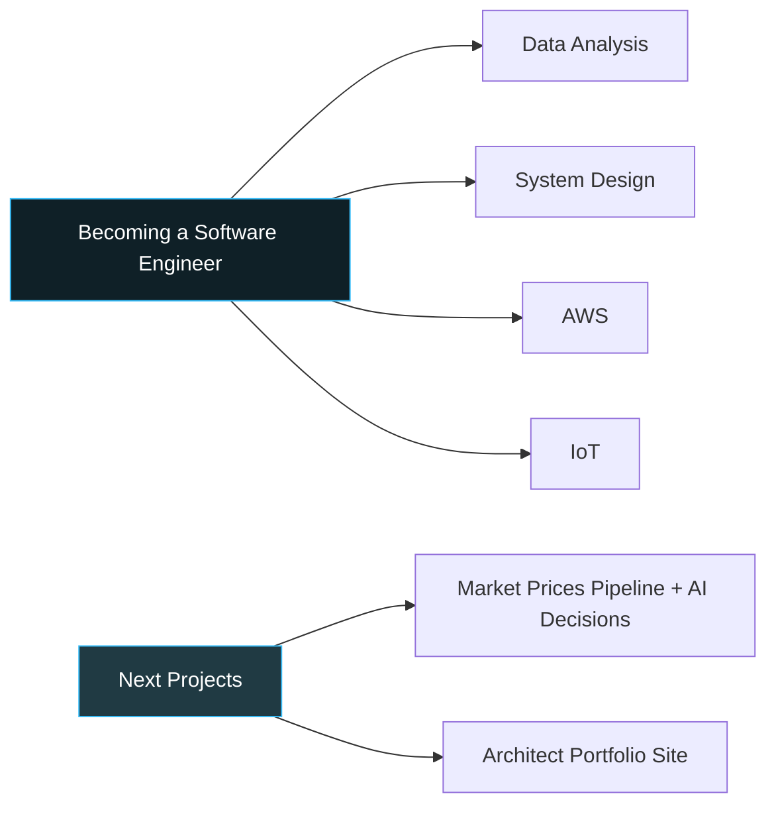

<div align="center">


<a href="https://amastroy.com">
  
</a>

<br/><br/>


</div>

<br/>

## 💫 About Me

I'm a **third-year student at the Faculty of Science in Oujda**, dedicating myself to learning as many programming topics as I can on the road to **becoming a software engineer**. My journey started at **Zone01**, where I learned the fundamentals of Bash and Go — and more importantly, that a programming language is a tool, not an identity.

```yaml
whoami:
  name: Mohamed Ali Amara
  role: 3rd-year student @ Faculty of Science, Oujda
  goal: Become a software engineer
  projects_shipped: 2
  stack: Next.js, React, Flutter
  currently_learning: Data Analysis, System Design, AWS, IoT
  philosophy: "It ain't simple, but it's worth it."
```

<br/>

## 🚀 Projects

<table>
<tr>
<td width="50%" valign="top">

### 🌱 [Amastroy](https://amastroy.com) — ✅ Done
A marketplace platform for **public and private markets** (*marchés publics et privés*), including **purchase orders** (*bons de commande*). Designed and shipped as a live product.

</td>
<td width="50%" valign="top">

### 🧮 Mathéconfiance — ✅ Done
A **gamified education platform** built for a professor teaching **online foreign students and engineers**, making learning math more engaging and motivating.

</td>
</tr>
</table>

<br/>

## 🔭 Up Next

<table>
<tr>
<td width="50%" valign="top">

### 📈 Market Prices Data Pipeline
A data pipeline that collects and processes market prices so an **AI can make buy / sell decisions**.

</td>
<td width="50%" valign="top">

### 🏛️ Architect Portfolio Website
A **beautiful, polished portfolio site** for an architect — where design and engineering meet.

</td>
</tr>
</table>

<br/>

## 🏆 Achievements & Milestones

<table>
<tr>
<td width="50%" valign="top">

### 🥇 1st Place — Meet the Lead
**7th Edition, 2025**
Placed first in a competitive team-based challenge.

</td>
<td width="50%" valign="top">

### 🎯 Finalist — Hackchrono
**1st Edition**
A pivotal experience — learned to analyze failure and iterate toward success.

</td>
</tr>
<tr>
<td width="50%" valign="top">

### 🐳 Collaborative Lead — Dockerized Workflows
Streamlined development across the club's portfolio projects using Docker.

</td>
<td width="50%" valign="top">

### 🌱 Founder — Amastroy
Designed and shipped a live platform for public and private markets at [amastroy.com](https://amastroy.com).

</td>
</tr>
</table>

<br/>

## 🛠️ Current Focus

<div align="center">



</div>

<br/>

## 💻 Tech Stack

<div align="center">

**Languages**


**Main Stack**


**Tools & Databases**


**Currently Learning**


</div>

<br/>

## 🌍 Someday List

> 🇨🇳 **Learn Chinese (Mandarin)** — I truly want to, but I can't plan it yet since I don't have the free time. One day!

<br/>

## 📊 Activity & Stats

<div align="center">


</div>

> 📌 Not chasing streaks — chasing consistent impact and real problems solved.

<br/>

## 🤝 Special Thanks

A big part of my technical mindset comes from the **Zone01 Association**. To my friends from the Zone01 Piscine — **Abd Noor, Ahmed, Hamza, Mimone, Laarbi, Reda, and Youssef** — thank you for proving that programming is about deep thinking and shared struggle.

> *"It ain't simple, but it's worth it."*

<br/>

## 🌐 Connect With Me

<div align="center">

[](https://discord.gg/alilacrim_04808)
[](https://linkedin.com/in/Ali)
[](mailto:mohamedali.amara.24@ump.ac.ma)
[](https://amastroy.com)

</div>


